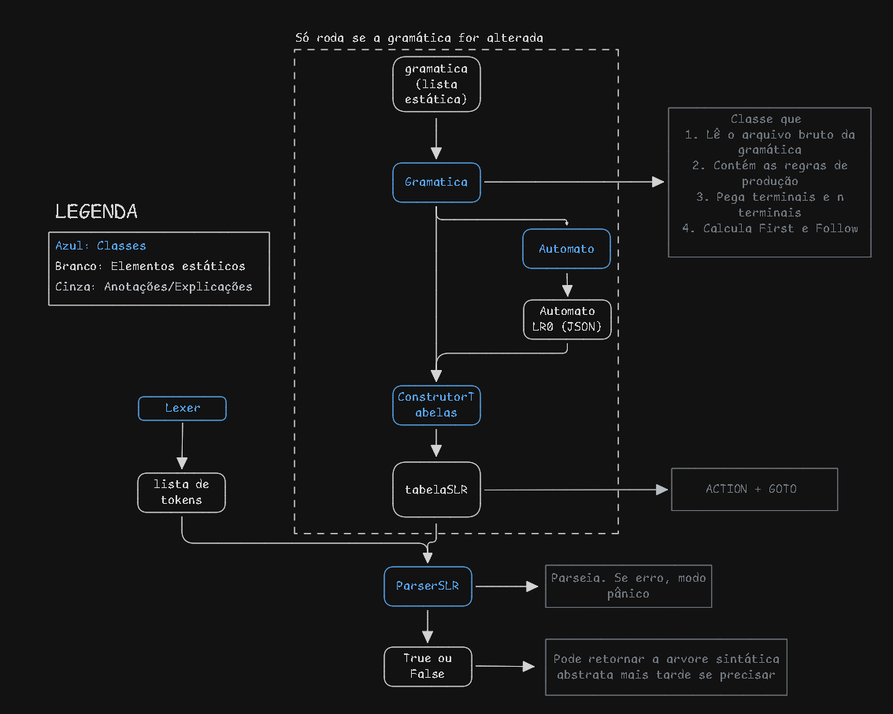

# Rascunho de Arquitetura: Analisador Sintático SLR(1)

Classes, divisão de responsabilidades das classes e ideia para o fluxo de processamento. Alguns nomes/labels podem estar diferentes no código, na imagem e nos textos abaixo. 

## 1. Arquitetura de Classes Proposta

O projeto é dividido em dois ecossistemas: o gerador da tabela SLR (que processa a gramática) e o compilador principal (que consome a tabela gerada).

### Ecossistema 1: O Gerador SLR (`src/gramatica.py`, `src/automato.py`, `src/construtor_tabelaSLR.py`)
Responsável por processar a gramática, construir o autômato LR(0) e montar a tabela sintática SLR(1).

*   **`Gramatica`** (em `src/gramatica.py`):
    *   **Responsabilidade**: Ler e carregar o arquivo JSON com as regras (`regras_producao.json`), sendo a única fonte da verdade da gramática. Identifica e indexa terminais e não-terminais.
    *   **Métodos Principais**: `get_simbolos()`, `calcular_conjunto_first()`, `calcular_conjunto_follow()`.
*   **`ItemLR`** (em `src/automato.py`):
    *   **Responsabilidade**: Estrutura simples para representar um item do autômato (ex: `<S'> -> . <chs>`). Guarda o lado esquerdo (`esq`), o lado direito (`dir`), a posição do "ponto" (`ponto`) e o símbolo após o ponto (`ponto_dir`).
    *   **Métodos Principais**: `imprimir()`.
*   **`Estado`** (em `src/automato.py`):
    *   **Responsabilidade**: Representa um estado do autômato LR(0), guardando seu identificador único (`id`) e a lista de itens que compõem seu fechamento (`fechamento`).
*   **`AutomatoLR0`** (em `src/automato.py`):
    *   **Responsabilidade**: Processar a `Gramatica` gerando todos os estados e transições válidas do autômato LR(0).
    *   **Métodos Principais**: `get_item_inicial(gramatica)`, `gerar_automato(gramatica)`, `fechamento(I, producoes)`, `desvio_estado(I, X, producoes)`, `exportar_json()` (salva estados e transições em `automato.json`).
*   **`SLRcell`** (em `src/construtor_tabelaSLR.py`):
    *   **Responsabilidade**: Representa uma célula da matriz da tabela SLR, armazenando `tipo` (`0`=empilha, `1`=reduz, `2`=aceita, `3`=erro vazio, `4`=erro reduz, `5`=goto) e `valor` (índice do estado alvo ou da regra de produção).
*   **`ConstrutorTabelaSLR`** (em `src/construtor_tabelaSLR.py`):
    *   **Responsabilidade**: Unir o `AutomatoLR0` e os conjuntos Follow da `Gramatica` para gerar a matriz bidimensional de células `SLRcell`.
    *   **Métodos Principais**: `construir_tabelaSLR(gramatica, automato)`, `exportar_json()`.

### Ecossistema 2: O Compilador Principal (Orquestrador)
É a esteira principal que roda quando queremos compilar um código da linguagem `C-Hurras`.

*   **`Token`** (em `src/Token.py`):
    *   **Responsabilidade**: Classe de modelo simples. Guarda `texto`, `categoria` e `linha`.
*   **`Lexer`** (em `src/analisador_lexico.py`):
    *   **Responsabilidade**: Fazer a varredura de caracteres do código-fonte por meio de um DFA e gerar a fita de tokens.
    *   **Métodos Principais**: `__init__()`, `analisar_lexico(codigo)`.
*   **`ParserSLR`** (em `src/analisador_sintatico.py`):
    *   **Responsabilidade**: O núcleo da Fase 2. Máquina Shift-Reduce orientada a pilha de estados e tabela SLR.
    *   **Métodos Principais**: 
        *   `__init__()`: Inicializa carregando a instância de `Gramatica`.
        *   `simbolo(term)`: Consulta o índice numérico de um símbolo na gramática.
        *   `criar_tabelaSLR()`: Instancia `AutomatoLR0` e `ConstrutorTabelaSLR`, gerando a matriz `tabelaSLR` (e exportando `automato.json`).
        *   `analisar_sintaxe(lista_tokens)`: Método de entrada que constrói a tabela SLR e chama `analisar_sintaxeAUX()`.
        *   `analisar_sintaxeAUX(tokens, tabelaSLR)`: Executa o loop principal Shift-Reduce e o tratamento de erros em Modo Pânico.
*   **`Compilador`** (em `src/compilador.py`):
    *   **Responsabilidade**: Classe orquestradora que instancia `Lexer` e `ParserSLR` e conduz o pipeline de compilação.
    *   **Métodos Principais**: `__init__()`, `compilar(codigo)`.

---

## 2. Sequência de Chamadas (Fluxo de Execução)

O fluxo de dados ao compilar um código fonte (ex: `codigo.churras`):

1.  **Início**: O arquivo principal (`main.py`) lê o código-fonte em texto do arquivo `.churras` e instancia a classe `Compilador`.
2.  **Orquestração (`Compilador`)**:
    *   Instancia `lexer = Lexer()` e `parser = ParserSLR()` (que internamente instancia `Gramatica()`, lendo `regras_producao.json` e calculando os símbolos e conjuntos First/Follow).
    *   Chama `compilar(codigo)`.
3.  **Chamada Léxica**:
    *   Chama `lista_tokens = lexer.analisar_lexico(codigo)`.
    *   O retorno é uma lista de objetos `Token` (finalizada pelo token `$`). Erros léxicos são reportados nessa etapa.
4.  **Chamada Sintática e Construção da Tabela**:
    *   Inicia a análise passando a fita léxica: `parser.analisar_sintaxe(lista_tokens)`.
    *   O parser chama `criar_tabelaSLR()`, que gera o `AutomatoLR0` (exportando `automato.json`) e constrói a matriz `tabelaSLR` via `ConstrutorTabelaSLR.construir_tabelaSLR(gramatica, automato)`.
    *   Em seguida, invoca `analisar_sintaxeAUX(lista_tokens, tabelaSLR)`.
5.  **Loop Shift-Reduce (`analisar_sintaxeAUX()`)**:
    *   O Parser inicia a pilha intercalando símbolos e estados: `stack = ["$", 0]` e ponteiro de entrada `ip = 0`.
    *   Enquanto `ip < len(tokens)`:
        *   Obtém o estado no topo `s = stack[-1]` e o token atual `a = tokens[ip]`.
        *   Consulta a célula na tabela: `act = tabelaSLR[s][simbolo(a.categoria)]`.
        *   Se `act.tipo == 0` (**Empilha / Shift**): Empilha `a.categoria` e o novo estado `act.valor` (`stack.append(a.categoria)`, `stack.append(act.valor)`). Avança `ip += 1`.
        *   Se `act.tipo == 1` (**Reduz / Reduce**): Para a regra `producoes[act.valor]`, se o lado direito não for vazio (`'~'`), desempilha `2 * len(prod_dir)` elementos (símbolo + estado para cada item do lado direito). Consulta o estado exposto `s_prime = stack[-1]`, empilha o não-terminal do lado esquerdo e empilha o estado de desvio `tabelaSLR[s_prime][simbolo(nao_terminal)].valor`. *O ponteiro `ip` **não** avança nesta operação.*
        *   Se `act.tipo == 2` (**Aceita / Accept**): Sucesso! Fim do laço de análise.
        *   Caso contrário (**Erro / Modo Pânico**): Marca `teve_erro = True`, exibe mensagem de erro sintático indicando o token e a linha, e tenta recuperar:
            *   Se `act.tipo == 3` (erro de célula vazia): descarta o token atual avançando `ip += 1`.
            *   Se `act.tipo == 4` (erro de redução): executa a redução associada na pilha.
6.  **Fim do Programa**: `analisar_sintaxe` retorna `not teve_erro`. Se retornar `True`, o `Compilador` imprime a mensagem de sucesso (`"Compilação foi um sucesso! Churras no ponto"`).
