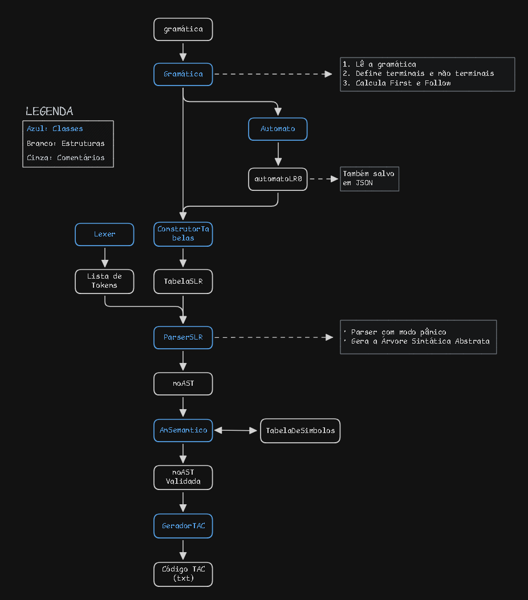

# Rascunho de Arquitetura: Compilador C-Hurras (Fases 2 e 3)

Classes, divisão de responsabilidades das classes e ideia para o fluxo de processamento. Alguns nomes/labels podem estar diferentes no código, na imagem e nos textos abaixo. 

## 1. Arquitetura de Classes Proposta

O projeto é dividido em dois ecossistemas: o gerador da tabela SLR (que processa a gramática) e o compilador principal (que consome a tabela gerada, monta a AST, valida a semântica e gera código intermediário).

### Ecossistema 1: O Gerador SLR (`src/gramatica.py`, `src/automato.py`, `src/construtor_tabelaSLR.py`)
Responsável por processar a gramática, construir o autômato LR(0) e montar a tabela sintática SLR(1).

*   **`Gramatica`** (em `src/gramatica.py`):
    *   **Responsabilidade**: Ler e carregar o arquivo JSON com as regras (`regras_producao.json`), sendo a única fonte da verdade da gramática. Identifica e indexa terminais e não-terminais, além de armazenar as instruções de criação de nós da AST associadas a cada produção (`regras_semanticas`).
    *   **Métodos Principais**: `get_simbolos()`, `calcular_conjunto_first()`, `calcular_conjunto_follow()`.
*   **`ItemLR`** (em `src/automato.py`):
    *   **Responsabilidade**: Estrutura simples para representar um item do autômato (ex: `<S'> -> . <chs>`). Guarda o lado esquerdo (`esq`), o lado direito (`dir`), a posição do "ponto" (`ponto`) e o símbolo após o ponto (`ponto_dir`).
    *   **Métodos Principais**: `imprimir()`.
*   **`Estado`** (em `src/automato.py`):
    *   **Responsabilidade**: Representa um estado do autômato LR(0), guardando seu identificador único (`id`) e a lista de itens que compõem seu fechamento (`fechamento`).
*   **`AutomatoLR0`** (em `src/automato.py`):
    *   **Responsabilidade**: Processar a `Gramatica` gerando todos os estados e transições válidas do autômato LR(0).
    *   **Métodos Principais**: `get_item_inicial(gramatica)`, `gerar_automato(gramatica)`, `fechamento(I, producoes)`, `desvio_estado(I, X, producoes)`, `exportar_json()` (salva estados e transições em `automato.json`).
*   **`SLRcell`** (em `src/construtor_tabelaSLR.py`):
    *   **Responsabilidade**: Representa uma célula da matriz da tabela SLR, armazenando `tipo` (`0`=empilha, `1`=reduz, `2`=aceita, `3`=erro vazio, `4`=erro reduz, `5`=goto) e `valor` (índice do estado alvo ou da regra de produção).
*   **`ConstrutorTabelaSLR`** (em `src/construtor_tabelaSLR.py`):
    *   **Responsabilidade**: Unir o `AutomatoLR0` e os conjuntos Follow da `Gramatica` para gerar a matriz bidimensional de células `SLRcell`.
    *   **Métodos Principais**: `construir_tabelaSLR(gramatica, automato)`, `exportar_json()`.

### Ecossistema 2: O Compilador Principal (Orquestrador, AST, Semântico e TAC)
É a esteira principal que roda quando queremos compilar um código da linguagem `C-Hurras`.

*   **`Token`** (em `src/Token.py`):
    *   **Responsabilidade**: Classe de modelo simples. Guarda `texto`, `categoria` e `linha`.
*   **`Lexer`** (em `src/analisador_lexico.py`):
    *   **Responsabilidade**: Fazer a varredura de caracteres do código-fonte por meio de um DFA e gerar a fita de tokens.
    *   **Métodos Principais**: `__init__()`, `analisar_lexico(codigo)`.
*   **`noAST`** (em `src/arvore_ast.py`):
    *   **Responsabilidade**: Estrutura de nó genérico único da Árvore Sintática Abstrata. Guarda `tipo` (rótulo do nó, ex: `"declaracao"`, `"operacao"`, `"if"`), `valor` (lexema ou operador), `linha` e lista de nós `filhos`.
    *   **Métodos e Funções Auxiliares**: `imprimir()`, `token_para_no()` e `criar_no()` (descarta tokens de pontuação/escopo `;`, `,`, `{`, `}`, `(`, `)`, palavras-chave redundantes e vazios `~`, achata listas `<churras>` e `<saida_comp>`, unifica operações sob `tipo="operacao"` e pendura o operando esquerdo no operador da cauda para deixar a árvore abstrata).
*   **`ParserSLR`** (em `src/analisador_sintatico.py`):
    *   **Responsabilidade**: O núcleo da Fase 2 integrado à construção da AST. Máquina Shift-Reduce orientada a pilha de estados (`stack`) e pilha paralela da árvore (`stack_ast`) que executa `criar_no` a cada redução (`act.tipo == 1`).
    *   **Métodos Principais**: 
        *   `__init__()`: Inicializa carregando a instância de `Gramatica` e `self.AST = None`.
        *   `simbolo(term)`: Consulta o índice numérico de um símbolo na gramática.
        *   `criar_tabelaSLR()`: Instancia `AutomatoLR0` e `ConstrutorTabelaSLR`, gerando a matriz `tabelaSLR` (e exportando `automato.json`).
        *   `analisar_sintaxe(lista_tokens)`: Método de entrada que constrói a tabela SLR e retorna o resultado de `analisar_sintaxeAUX()`.
        *   `analisar_sintaxeAUX(tokens, tabelaSLR)`: Executa o loop Shift-Reduce, constrói a AST em paralelo em `stack_ast` e retorna a raiz `self.AST` (`noAST`) se aceitou sem erros, ou `None` caso algum token tenha ativado o modo pânico.
*   **`TabelaDeSimbolos`** (em `src/tabela_simbolos.py`):
    *   **Responsabilidade**: Gerenciar escopos e armazenar identificadores declarados e seus tipos.
*   **`AnalisadorSemantico`** (em `src/analisador_semantico.py`):
    *   **Responsabilidade**: Receber a raiz da `AST` gerada pelo `ParserSLR`, percorrer os nós validando regras semânticas junto à `TabelaDeSimbolos` e anotar os tipos nos nós da árvore.
*   **`GeradorTAC`** (em `src/gerador_tac.py`):
    *   **Responsabilidade**: Percorrer a `AST` validada e emitir a lista de instruções de Código de Três Endereços (temporários, rótulos e saltos).
*   **`Compilador`** (em `src/compilador.py`):
    *   **Responsabilidade**: Classe orquestradora que instancia `Lexer`, `ParserSLR`, `AnalisadorSemantico` e `GeradorTAC`, conduzindo o pipeline completo de compilação.
    *   **Métodos Principais**: `__init__()`, `compilar(codigo)`.

---

## 2. Sequência de Chamadas (Fluxo de Execução)

O fluxo de dados ao compilar um código fonte (ex: `codigo.churras`):

1.  **Início**: O arquivo principal (`main.py`) lê o código-fonte em texto do arquivo `.churras` e instancia a classe `Compilador`.
2.  **Orquestração (`Compilador`)**:
    *   Instancia `lexer = Lexer()`, `parser = ParserSLR()`, `semantico = AnalisadorSemantico()` e `gerador_tac = GeradorTAC()`.
    *   Chama `compilar(codigo)`.
3.  **Chamada Léxica**:
    *   Chama `lista_tokens = lexer.analisar_lexico(codigo)`.
    *   O retorno é uma lista de objetos `Token` (finalizada pelo token `$`). Erros léxicos são reportados nessa etapa.
4.  **Chamada Sintática e Construção da Tabela**:
    *   Inicia a análise passando a fita léxica: `noAST = parser.analisar_sintaxe(lista_tokens)`.
    *   O parser chama `criar_tabelaSLR()`, que gera o `AutomatoLR0` e constrói a matriz `tabelaSLR` via `ConstrutorTabelaSLR.construir_tabelaSLR(gramatica, automato)`.
    *   Em seguida, invoca `analisar_sintaxeAUX(lista_tokens, tabelaSLR)`.
5.  **Loop Shift-Reduce e Construção da AST (`analisar_sintaxeAUX()`)**:
    *   O Parser inicia a pilha de estados `stack = ["$", 0]`, a pilha paralela da árvore `stack_ast = []` e o ponteiro de entrada `ip = 0`.
    *   Enquanto `ip < len(tokens)`:
        *   Obtém o estado no topo `s = stack[-1]` e o token atual `a = tokens[ip]`.
        *   Consulta a célula na tabela: `act = tabelaSLR[s][simbolo(a.categoria)]`.
        *   Se `act.tipo == 0` (**Empilha / Shift**): Empilha `a.categoria` e `act.valor` em `stack`, e empilha o objeto `Token` `a` em `stack_ast`. Avança `ip += 1`.
        *   Se `act.tipo == 1` (**Reduz / Reduce**): Para a regra `producoes[act.valor]`, desempilha símbolos e estados de `stack` e os elementos correspondentes de `stack_ast`. Executa `criar_no(regra_sem, simb_esq, elementos_desempilhados)` e empilha o `noAST` resultante em `stack_ast`. Consulta o estado exposto `s_prime = stack[-1]`, empilha o não-terminal e o estado de desvio em `stack`. *O ponteiro `ip` **não** avança nesta operação.*
        *   Se `act.tipo == 2` (**Aceita / Accept**): Sucesso! Salva a raiz da árvore `self.AST = stack_ast[-1]`. Fim do laço de análise.
        *   Caso contrário (**Erro / Modo Pânico**): Marca `teve_erro = True`, exibe mensagem de erro sintático indicando o token e a linha, e tenta recuperar descartando token (`act.tipo == 3`) ou reduzindo e mantendo `stack_ast` sincronizada (`act.tipo == 4`).
    *   Ao final do laço, retorna `self.AST` se `not teve_erro`, ou `None` caso tenha ocorrido erro sintático.
6.  **Análise Semântica (`AnalisadorSemantico`)**:
    *   Se `noAST is not None`, o `Compilador` passa a árvore para `semantico.analisar(noAST)`.
    *   O analisador percorre a `AST`, registra e consulta variáveis na `TabelaDeSimbolos` e valida tipos e escopos.
7.  **Geração de Código Intermediário (`GeradorTAC`)**:
    *   Se não houver erros semânticos, o `Compilador` passa a `AST` validada para `gerador_tac.gerar(noAST)`, produzindo o Código de Três Endereços (TAC).
8.  **Fim do Programa**: Exibe ou salva o código de três endereços gerado e imprime a mensagem de sucesso.
